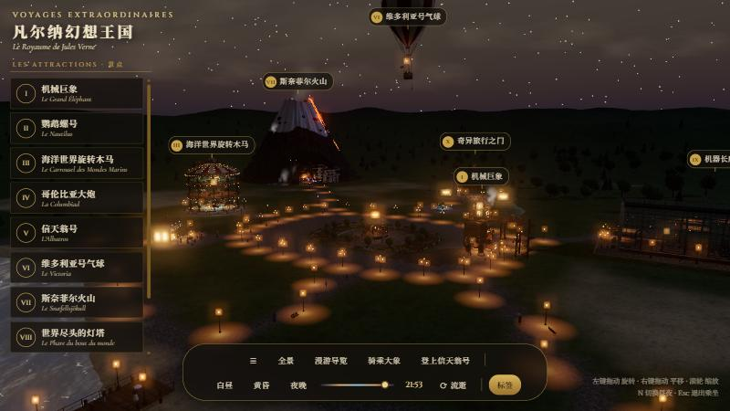
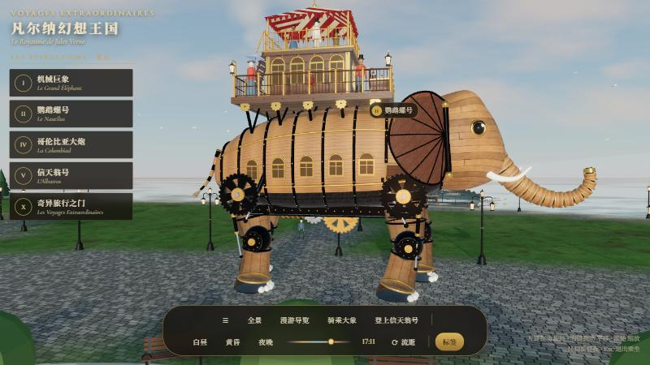
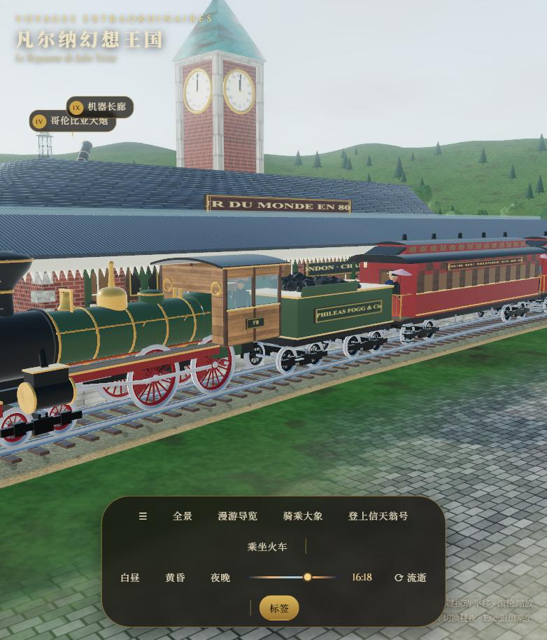
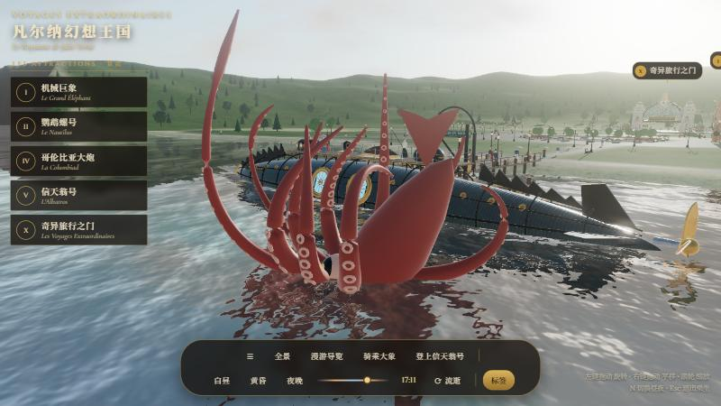
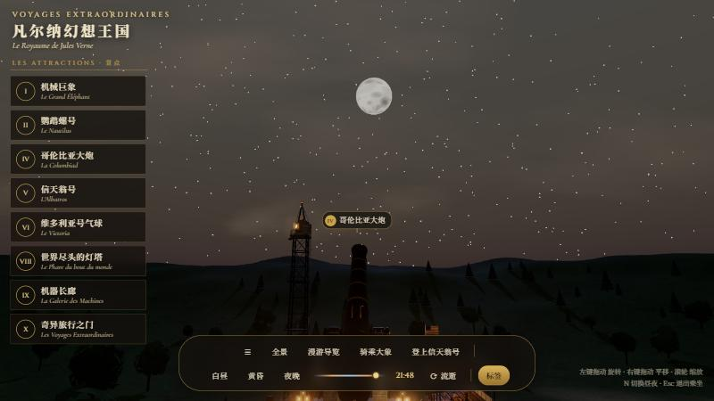

# 凡尔纳幻想王国 · Voyages Extraordinaires

一座完全用代码**程序化建模**的儒勒·凡尔纳科幻主题乐园（Three.js）。灵感来自南特“岛上机器”（Les Machines de l'île）的机械巨象。
没有任何外部模型或图片：所有几何体、木纹、铆接钢板、黄铜、铜绿、石砌、卵石、条纹帆布……都在浏览器里实时生成。



| 机械巨象 | 环球蒸汽火车 |
|---|---|
|  |  |
| **鹦鹉螺号与大王乌贼** | **哥伦比亚大炮瞄准月亮** |
|  |  |

> 当前版本：**v1.0.0**（README 中的 `docs/` 截图为浏览器实时渲染画面）

## 运行

```bash
npm install
npm run dev
```

然后打开 <http://127.0.0.1:5354>。

## 景点

| # | 景点 | 出处 |
|---|------|------|
| I | 机械巨象 Le Grand Éléphant | 南特“岛上机器”·《蒸汽屋》 |
| II | 鹦鹉螺号 + 大王乌贼 | 《海底两万里》1870 |
| III | 海洋世界旋转木马 | 《海底两万里》 |
| IV | 哥伦比亚大炮 | 《从地球到月球》1865 |
| V | 信天翁号飞行器 | 《征服者罗比尔》1886 |
| VI | 维多利亚号气球 | 《气球上的五星期》1863 |
| VII | 斯奈菲尔火山 | 《地心游记》1864 |
| VIII | 世界尽头的灯塔 | 《世界尽头的灯塔》1905 |
| IX | 机器长廊 | 世博会钢铁玻璃大厅 |
| X | 奇异旅行之门 | 乐园正门 |
| XI | 环球蒸汽火车 + 查令十字车站 | 《八十天环游地球》1872 |

## 操作

- 左键拖动旋转 · 右键拖动平移 · 滚轮缩放
- 左侧列表 / 场景中的标签：飞到对应景点
- 「漫游导览」自动巡游所有景点；「骑乘大象」「登上信天翁号」「乘坐火车」第一人称乘坐
- 昼夜：白昼 / 黄昏 / 夜晚、时间滑块、「流逝」自动昼夜循环；键盘 `N` 切换昼夜，`Esc` 退出乘坐

## 结构

```
src/
  main.js          渲染器、天空/水面/昼夜、后期辉光、相机导览、乘坐模式、UI
  materials.js     程序贴图（逐像素噪声生成）与共享材质库
  util.js          建模工具：管件、齿轮、栏杆、桁架、灯具、游客、几何合并
  world.js         地形（splat 混合着色）、海岸、步道、树木、路灯、花坛、人群
  content.js       景点导览文字
  attractions/     各景点模块：createXxx(M, ctx) → { group, update, focus }
scripts/check-module.mjs   无头检查景点模块（网格数、三角形数、包围盒）
```
